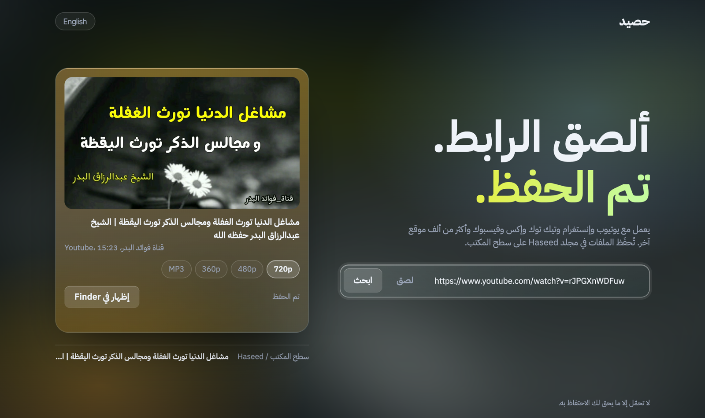
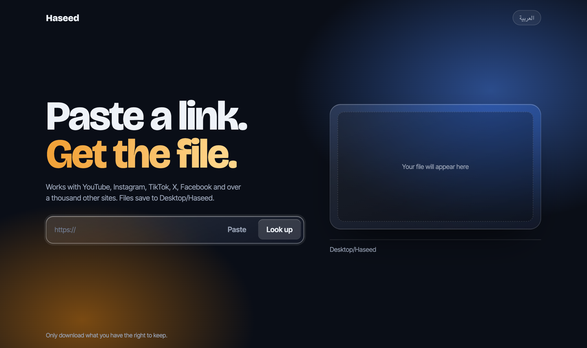
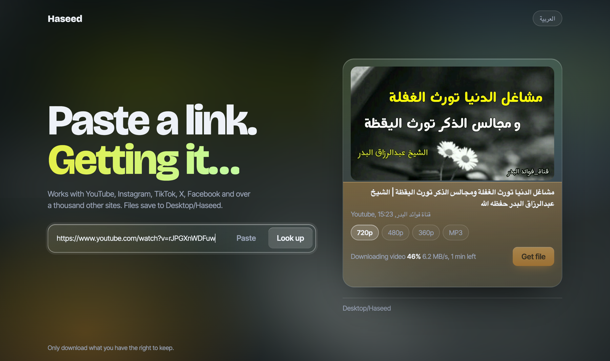

<div dir="rtl">

# حصيد (Haseed)

[English](README.md)

ألصق الرابط، واحصل على الملف. حصيد صفحة صغيرة تعمل على جهازك أنت، وتحمّل المقاطع من يوتيوب وإنستغرام وتيك توك وإكس وفيسبوك و[أكثر من ألف موقع آخر](https://github.com/yt-dlp/yt-dlp/blob/master/supportedsites.md)، باستخدام [yt-dlp](https://github.com/yt-dlp/yt-dlp).



| الشاشة الأولى | أثناء التحميل |
|---|---|
|  |  |

- اختر الجودة: كل المقاسات المتوفرة للمقطع حتى 4K، أو صوت فقط MP3
- شريط تقدّم مباشر أثناء التحميل
- الملفات تعمل على QuickTime والآيفون، وما لا يعمل يُحوَّل تلقائيًا إلى H.264
- تُحفَظ في مجلد **Haseed** على سطح المكتب
- الاستخدام من الآيفون أو الأندرويد دون تطبيق
- واجهة بالعربية والإنجليزية (التبديل من أعلى الصفحة)
- لا يُرفَع شيء إلى أي مكان، ولا إعلانات ولا حسابات

## طريقة التشغيل

تحتاج إلى [بايثون 3](https://www.python.org/downloads/). على ويندوز، فعّل خيار **Add python.exe to PATH** أثناء التثبيت.

1. حمّل هذا المستودع (الزر الأخضر **Code** ثم **Download ZIP**) وفُكّ الضغط.
2. شغّله:
   - **ماك:** انقر مرتين على `start.command`. في المرة الأولى انقر بالزر الأيمن ثم **Open** لتجاوز تنبيه الأمان.
   - **ويندوز:** انقر مرتين على `start.bat`.
3. يفتح المتصفح حصيد على العنوان http://localhost:8788. اترك النافذة مفتوحة أثناء الاستخدام، وأغلقها للإيقاف.

التشغيل الأول يستغرق دقيقة تقريبًا لتثبيت ما يحتاجه (yt-dlp وffmpeg وDeno) داخل مجلد `.venv` في المشروع. وفي كل تشغيل بعد ذلك يبحث عن نسخة أحدث من yt-dlp، لأن المواقع تتغيّر كثيرًا والنسخ القديمة تتوقف عن العمل.

## الاستخدام من الجوال (آيفون أو أندرويد)

دون تثبيت أي تطبيق. يبقى حصيد يعمل على جهاز الكمبيوتر، ويستخدمه جوالك عبر الواي فاي.

1. على الكمبيوتر، اضغط **على الجوال** (أعلى الصفحة). سيظهر عنوان مثل `http://192.168.1.20:8788` ورمز من 6 أرقام.
2. على الجوال، وهو متصل **بنفس شبكة الواي فاي**، افتح ذلك العنوان في سفاري أو كروم وأدخل الرمز.
3. ألصق الرابط واضغط **احصل على الملف**. عند الانتهاء اضغط **حفظ على الجوال**.
   - **آيفون:** يُحفَظ المقطع في تطبيق الملفات (التنزيلات). ولنقله إلى الصور: افتحه في الملفات ← مشاركة ← **حفظ الفيديو**.
   - **أندرويد:** يُحفَظ في مجلد التنزيلات.

وضع الجوال مغلق حتى تفعّله، ويُغلَق عند إعادة تشغيل حصيد. وبعد 5 محاولات خاطئة للرمز تُمنَع الجوالات 10 دقائق. الاتصال بين الجوال والكمبيوتر غير مشفّر، فاستخدمه على شبكتك الخاصة لا على شبكة عامة.

## أندرويد دون كمبيوتر (Termux)

يمكن تشغيل حصيد على الجوال نفسه عبر تطبيق [Termux](https://f-droid.org/packages/com.termux/) (ثبّته من F-Droid، فنسخة متجر Play قديمة).

<div dir="ltr">

1. In Termux, run once:
   ```
   pkg update && pkg install -y python ffmpeg git nodejs
   termux-setup-storage
   git clone https://github.com/AbuGha1th/haseed
   cd haseed && pip install -U yt-dlp
   ```
2. To start:
   ```
   cd ~/haseed && HASEED_NO_BROWSER=1 python server.py
   ```

</div>

3. افتح **http://localhost:8788** في كروم على الجوال. تُحفَظ الملفات داخل مجلد Termux في `Haseed`، وانسخها إلى ذاكرة الجوال بالأمر `cp ~/Haseed/* ~/storage/downloads/`.

## تنبيهات

- حصيد يعمل على جهازك فقط (`127.0.0.1`)، فلا يستطيع أحد غيرك الوصول إليه، إلا إذا فعّلت وضع الجوال، وهو يحتاج إلى الرمز.
- لا تحمّل إلا ما يحق لك الاحتفاظ به. بعض المواقع تمنع التحميل في شروطها، وأنت المسؤول عن طريقة استخدامك.
- حصيد غير تابع لمشروع yt-dlp. إن واجهت مشكلة في موقع معيّن فأبلغ عنها في حصيد أولًا، لا في yt-dlp.

</div>
