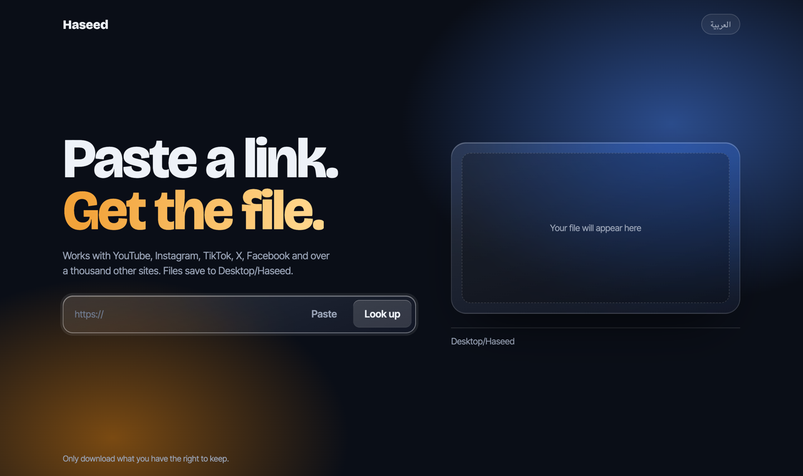
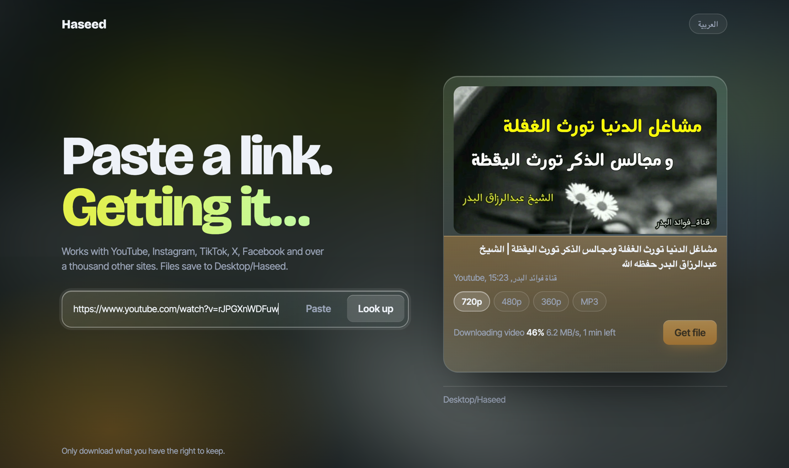
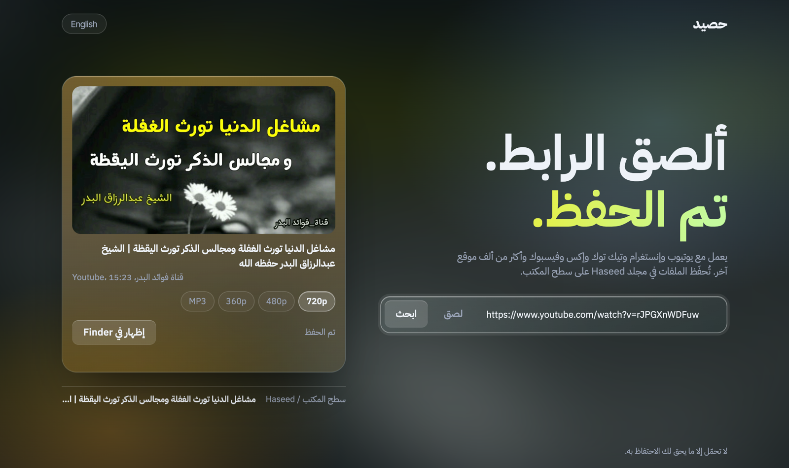

# Haseed (حصيد)

[العربية](README.ar.md)

Paste a link, get the file. Haseed is a small page that runs on your own computer and downloads videos from YouTube, Instagram, TikTok, X, Facebook and [over a thousand other sites](https://github.com/yt-dlp/yt-dlp/blob/master/supportedsites.md), using [yt-dlp](https://github.com/yt-dlp/yt-dlp).



<table>
  <tr><th width="50%">Downloading</th><th width="50%">Arabic interface</th></tr>
  <tr>
    <td width="50%"></td>
    <td width="50%"></td>
  </tr>
</table>

- Pick the quality: every size the video has, up to 4K, or MP3
- Live progress while it downloads
- Files play in QuickTime and on iPhone: anything else is converted to H.264
- Saved to a **Haseed** folder on your Desktop
- Use it from your iPhone or Android phone, no app needed
- English and Arabic interface (switch in the top corner)
- Nothing is uploaded anywhere, and there are no ads or accounts

## Release files

Download from the [latest release](https://github.com/AbuGha1th/haseed/releases/latest).

| File | Description |
|---|---|
| [Haseed-macOS.zip](https://github.com/AbuGha1th/haseed/releases/latest/download/Haseed-macOS.zip) | macOS (Intel and Apple Silicon). Unzip, then double-click `start.command`. Needs Python 3 |
| [Haseed-Windows.zip](https://github.com/AbuGha1th/haseed/releases/latest/download/Haseed-Windows.zip) | Windows 10 and 11. Unzip, then double-click `start.bat`. Needs Python 3 |
| [Haseed-Android.apk](https://github.com/AbuGha1th/haseed/releases/latest/download/Haseed-Android.apk) | Android 8 or newer, 64-bit phones. Everything is inside, no computer needed |
| iPhone | No app: use Haseed on your computer from Safari ([how](#use-it-from-your-phone-iphone-or-android)) |

**Android:** download the .apk on your phone and open it; Android asks once to allow installing apps from your browser or Files app. It isn't on the Play Store, because Google doesn't allow apps that download from YouTube. In other apps, tap **Share → Haseed** on a video to open it straight in Haseed. Files save to **Download/Haseed** and show up in your gallery.

## Run it

You need [Python 3](https://www.python.org/downloads/). On Windows, tick **Add python.exe to PATH** while installing.

1. Download **Haseed-macOS.zip** or **Haseed-Windows.zip** from the table above and unzip it.
2. Start it:
   - **Mac:** double-click `start.command`. The first time, right-click it → **Open** to get past the security prompt.
   - **Windows:** double-click `start.bat`.
3. Your browser opens Haseed at http://localhost:8788. Keep the window open while you use it, and close it to stop.

The first start takes a minute while it installs what it needs (yt-dlp, ffmpeg and Deno) into a `.venv` folder inside the project. Each later start checks for a newer yt-dlp, because sites change often and older versions stop working.

## Use it from your phone (iPhone or Android)

No app needed. Haseed keeps running on your computer, and your phone uses it over Wi-Fi.

1. On the computer, click **Use on phone** (top corner). It shows an address like `http://192.168.1.20:8788` and a 6-digit PIN.
2. On the phone, connected to the **same Wi-Fi**, open that address in Safari or Chrome and enter the PIN.
3. Paste a link and tap **Get file**. When it's done, tap **Save to phone**.
   - **iPhone:** the video goes to the Files app (Downloads). To put it in Photos, open it in Files → Share → **Save Video**.
   - **Android:** it goes to your Downloads.

Phone mode is off until you switch it on, and turns off when Haseed restarts. After 5 wrong PINs, phones are locked out for 10 minutes. The connection between phone and computer isn't encrypted, so use it on your own Wi-Fi, not public Wi-Fi.

## Android without a computer (Termux)

The easiest way is the **Haseed-Android.apk** above. If you'd rather not install an app, Haseed can also run on the phone using [Termux](https://f-droid.org/packages/com.termux/) (install it from F-Droid; the Play Store version is outdated).

1. In Termux, run these once:
   ```
   pkg update && pkg install -y python ffmpeg git nodejs
   termux-setup-storage
   git clone https://github.com/AbuGha1th/haseed
   cd haseed && pip install -U yt-dlp
   ```
2. To start Haseed, run:
   ```
   cd ~/haseed && HASEED_NO_BROWSER=1 python server.py
   ```
3. Open **http://localhost:8788** in Chrome on the phone. Files are saved in Termux's home folder under `Desktop/Haseed` (or `~/Haseed`); copy them to your phone storage with `cp ~/Haseed/* ~/storage/downloads/`.

## Good to know

- Haseed only listens on your own computer (`127.0.0.1`), so nobody else can reach it, unless you switch on phone mode, which needs the PIN.
- Download only what you have the right to keep. Some sites' terms forbid downloading, and you are responsible for how you use this.
- Haseed is not affiliated with yt-dlp. Report download problems for a specific site to Haseed first, not to yt-dlp.
